# PENETRATION TESTING REPORT

**Footprinting & Network Scanning Phases**
W2-PM-FINAL | Cybersecurity | Networkwalks

| Field | Detail |
|---|---|
| Pentester Name | Amna Abbas |
| Program/Batch | Cybersecurity Internship, Networkwalks (Batch B084) |
| Date | 13 November 2026 |
| Modules completed | W2-PM1 (Footprinting with multiple Kali tools), W2-PM5 (Zenmap network scanning) |
| Phase B target | networkwalks.com |
| Phase C target | my own home Wi-Fi network |
| Tools | Kali Linux (VirtualBox), Zenmap / Nmap (Windows) |

---

## 1. Liability Disclaimer

This report was prepared for educational purposes as part of the Networkwalks Cybersecurity Internship. All testing was limited to the targets allowed in my instructor's letter of authorization: the domain networkwalks.com (light information gathering only) and my own network (host discovery and port scanning only). No exploitation, brute force, denial-of-service, or access to any third-party data was attempted.

## 2. Introduction

Reconnaissance is the first step of any security test. Before testing anything, a tester collects information about the target: who owns it, what servers it uses, what software runs on it, and which devices and ports are reachable.

This week I did two kinds of reconnaissance:

- **Phase B (W2-PM1): Information gathering** about the domain `networkwalks.com` using command-line tools in Kali Linux.
- **Phase C (W2-PM5): Network scanning** with Nmap's graphical tool, Zenmap, on my own network.

## 3. Scope and Permission

My instructor's letter allows scanning **only my own network** and light footprinting of networkwalks.com. For this reason:

- All scans in Phase C were run on **my own home Wi-Fi network**, not on a hostel, university, or shared public network.
- I did not scan any network or device that belongs to someone else.
- Phase B tools only collect publicly available information about the domain using light, non-intrusive requests.

## 4. Tools Used

| Tool | Purpose |
|---|---|
| whois | Domain registration details |
| nslookup | DNS lookups (IP, MX, NS records) |
| dnsrecon | DNS record enumeration |
| WhatWeb | Website technology identification |
| wafw00f | Web Application Firewall detection |
| curl | HTTP header inspection |
| Zenmap / Nmap | Host discovery and port scanning |
| VirtualBox + Kali Linux | Testing environment |

---

## 5. Phase B: Information Gathering on networkwalks.com (Kali Linux)

### B1. WHOIS

**What it does:** Shows registration details of a domain: registrar, creation and expiry dates, and name servers.

```bash
whois networkwalks.com
```

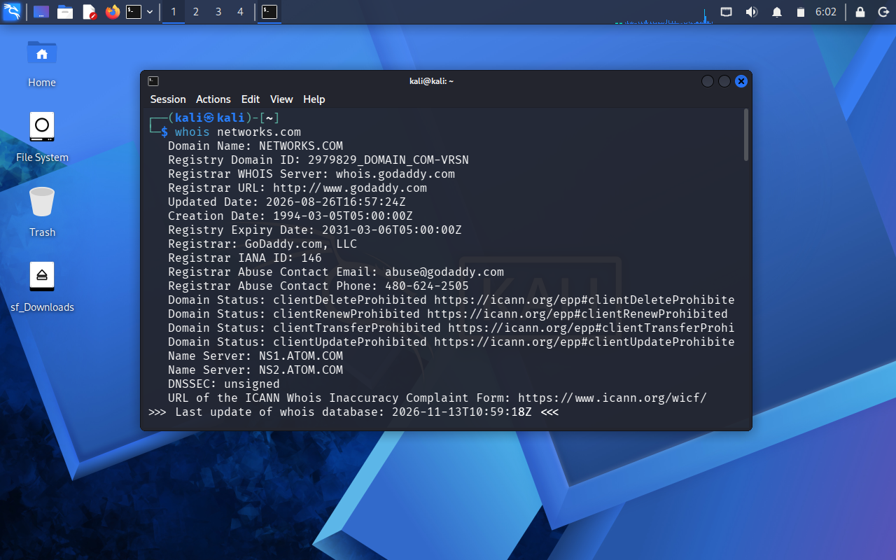

**What I found:** The registrar is GoDaddy.com, LLC. The creation date is 2026-08-05T05:00:00Z and the expiry date is 2031-03-06T05:00:00Z.

### B2. nslookup (IP address)

**What it does:** Converts the domain name into the IP address of the server.

```bash
nslookup networkwalks.com
```


**What I found:** The IP address is 192.232.216.135.

### B3. nslookup (MX records)

**What it does:** Shows which mail servers handle email for the domain.

```bash
nslookup -type=MX networkwalks.com
```


**What I found:** The MX record shows that email for networkwalks.com is handled by the mail server mail.networkwalks.com with priority 0. The query was answered by Google DNS (8.8.8.8) as a non-authoritative answer, which means the result came from a cached copy and not directly from the domain's own name server.

### B4. nslookup (NS records)

**What it does:** Shows the name servers that hold the domain's DNS records.

```bash
nslookup -type=NS networkwalks.com
```

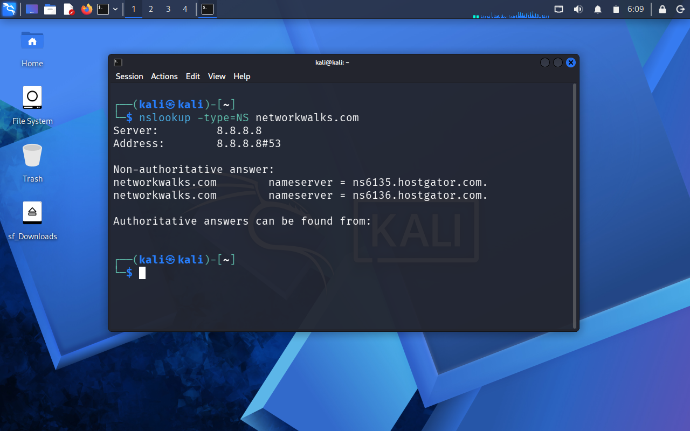

**What I found:** The name servers are ns6135.hostgator.com and ns6136.hostgator.com.

### B5. dnsrecon

**What it does:** Collects many DNS records (A, MX, NS, TXT, SOA) in one run.

```bash
dnsrecon -d networkwalks.com
```

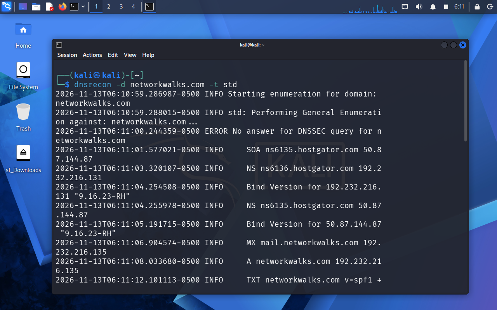

**What I found:** dnsrecon returned the main DNS records for networkwalks.com. The SOA and NS records show that the domain's DNS is managed by HostGator name servers (ns6135.hostgator.com and ns6136.hostgator.com), which suggests the domain is hosted with HostGator. The A record shows the website IP is 192.232.216.135, and the MX record shows the mail server mail.networkwalks.com uses the same IP, so the website and mail are on the same server. A TXT record with SPF (v=spf1) is present, which is used to control which servers can send email for the domain. The name servers also revealed their DNS software version (BIND 9.16.23-RH). dnsrecon reported no answer for the DNSSEC query, so DNSSEC does not appear to be enabled.

### B6. WhatWeb

**What it does:** Identifies the technologies a website uses, such as web server, CMS, and scripts.

```bash
whatweb networkwalks.com
```

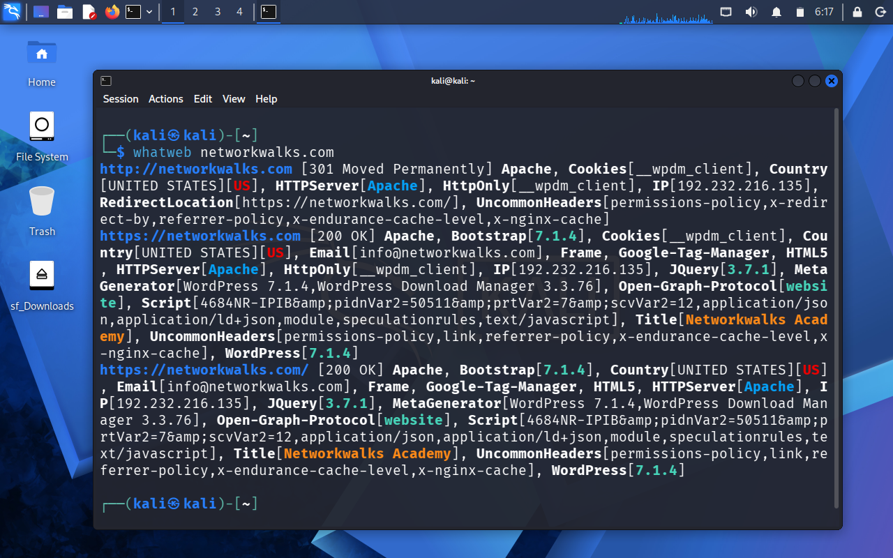

**What I found:** WhatWeb shows that networkwalks.com runs on an Apache web server at IP 192.232.216.135, located in the United States. The site first returns a 301 redirect from HTTP to HTTPS, then loads with a 200 OK response. The website is built with WordPress 7.1.4 and uses the WordPress Download Manager plugin (3.3.76). Other technologies detected are Bootstrap, jQuery 3.7.1, HTML5, and Google Tag Manager. The page title is "Networkwalks Academy" and the contact email info@networkwalks.com is publicly visible. The `__wpdm_client` cookie is marked HttpOnly, and caching-related headers (x-nginx-cache, x-endurance-cache-level) show that a caching layer is in use.

### B7. wafw00f

**What it does:** Checks whether the website is protected by a Web Application Firewall (WAF).

```bash
wafw00f https://networkwalks.com
```

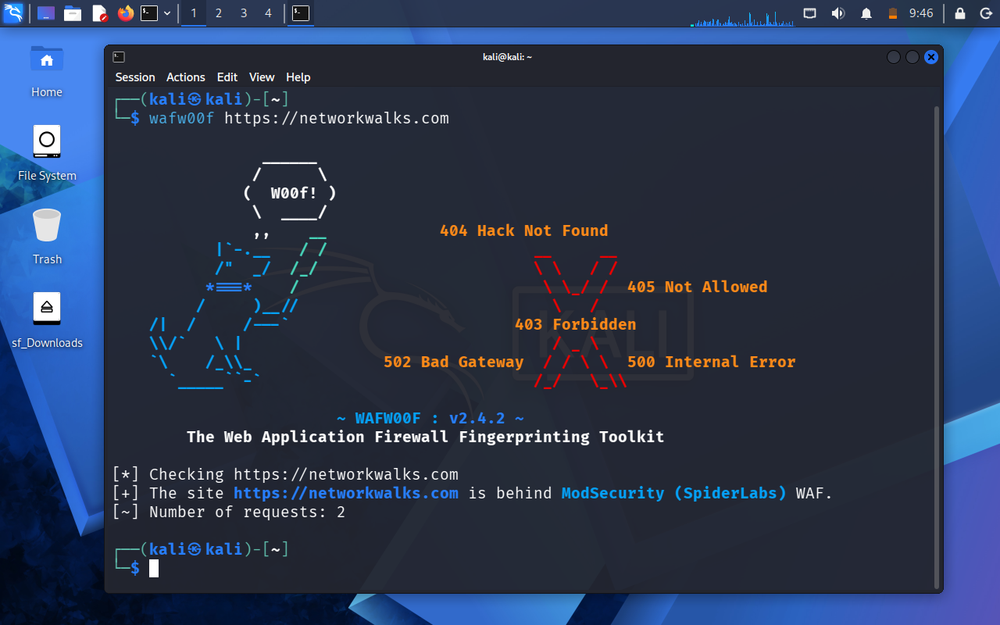

**What I found:** wafw00f detected that networkwalks.com is protected by a Web Application Firewall: ModSecurity (SpiderLabs). It needed only 2 requests to identify it. ModSecurity is an open-source WAF that works with the Apache web server, which matches the Apache server found earlier with WhatWeb (B6). A WAF filters malicious web traffic, such as SQL injection and cross-site scripting attempts, before it reaches the website. This means the site has an extra layer of protection.

### B8. curl (HTTP headers)

**What it does:** Fetches only the HTTP response headers, which can reveal the server type and security settings.

```bash
curl -I https://networkwalks.com
```

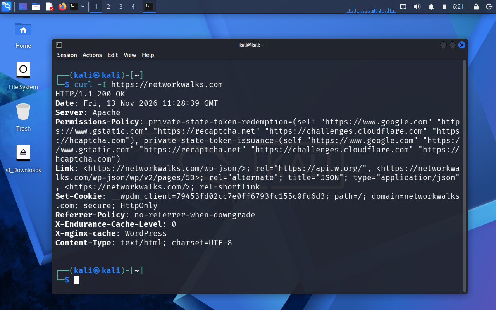

**What I found:** The curl request returned HTTP/1.1 200 OK, so the site is working. The Server header shows Apache, which matches the WhatWeb result. The Link header exposes the WordPress REST API (/wp-json/), confirming the site runs on WordPress. The `__wpdm_client` cookie is set with the Secure and HttpOnly flags, which is good practice. Security-related headers present are Permissions-Policy and Referrer-Policy. Caching headers (X-nginx-cache, X-Endurance-Cache-Level) show that a caching layer is used. I did not see headers such as Strict-Transport-Security, X-Frame-Options, X-Content-Type-Options, or Content-Security-Policy in this output, so these protections are not shown in the response.

---

## 6. Phase C: Network Scanning with Zenmap (Windows)

### C1. Installing Nmap and Zenmap

I downloaded Nmap (which includes Zenmap) from the official Nmap website (nmap.org) and installed it.

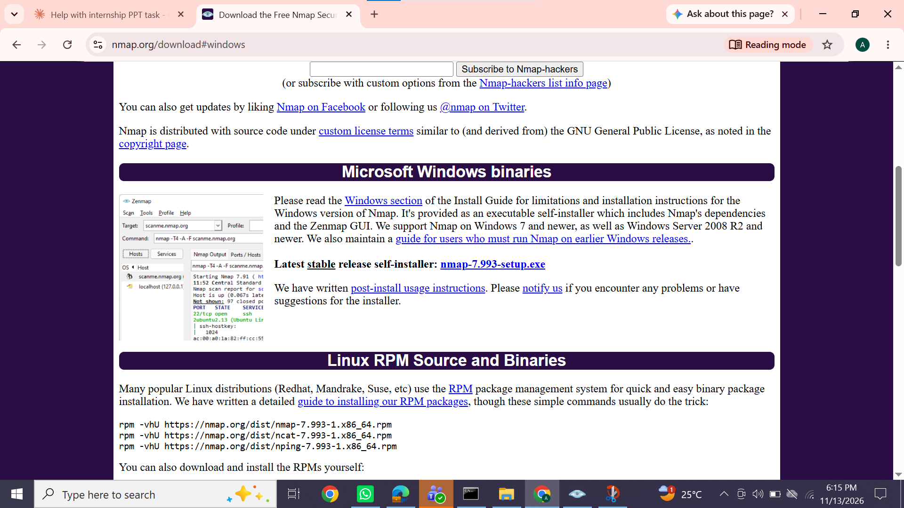


### C2. Finding my network details with ipconfig

I ran `ipconfig` in Command Prompt to find my network details. Only the Wi-Fi adapter matters; "Media disconnected" blocks and IPv6 lines were ignored.

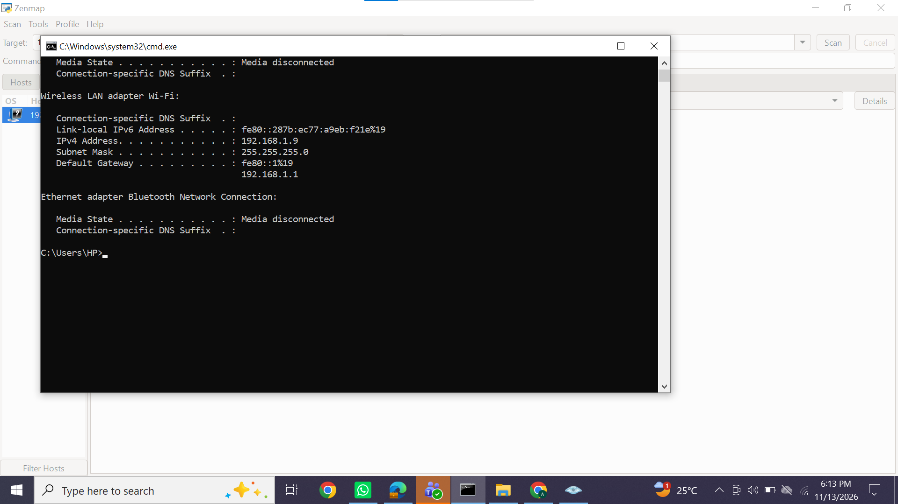

| Item | Value | Meaning |
|------|-------|---------|
| IPv4 Address | 192.168.1.9 | My PC's address on my network |
| Subnet Mask | 255.255.255.0 | A /24 network (256 addresses) |
| Default Gateway | 192.168.1.1 | My router |

**Targets used:**

- Scans 1 and 2 scan the whole network, so the last number becomes 0 and `/24` is added: **192.168.1.0/24**
- Scan 3 scans only my own PC, so I used the exact IP with no `/24`: **192.168.1.9**

### C3. Scan 1: Ping scan (find live devices)

- **Target:** 192.168.1.0/24
- **Profile:** Ping scan (`nmap -sn`)
- **Purpose:** Discover which devices are online.

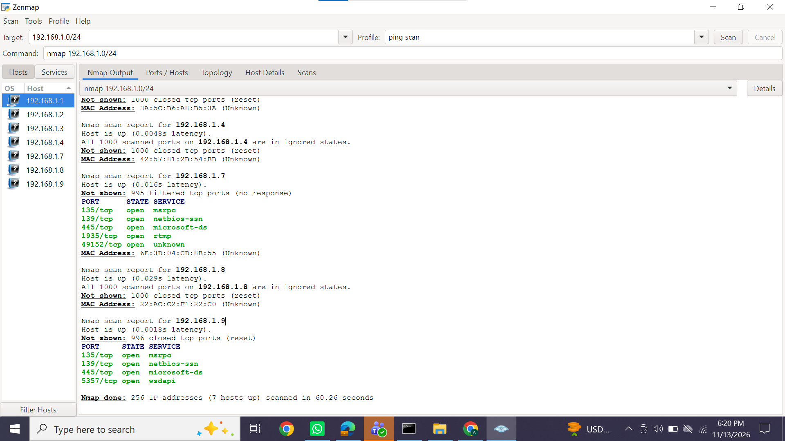

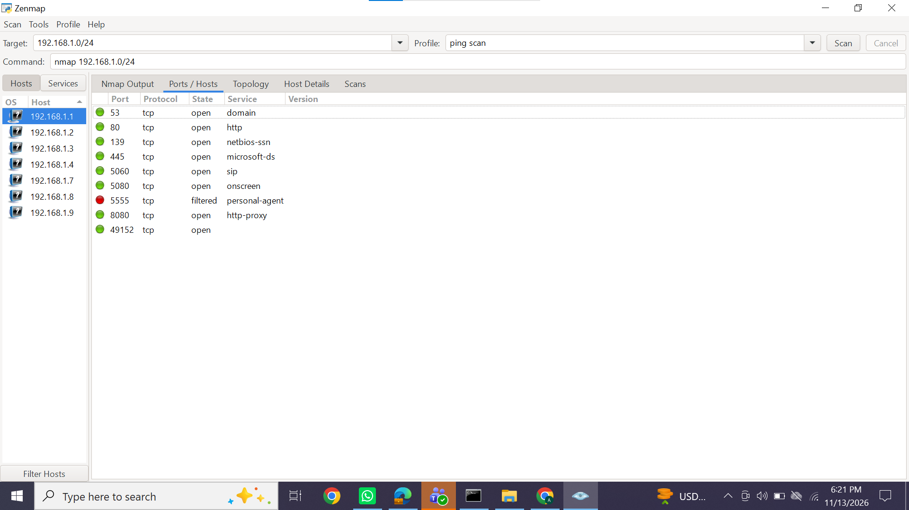

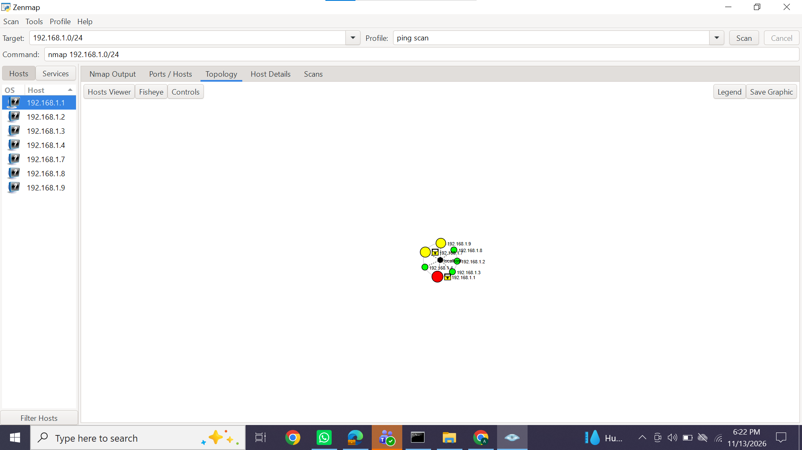

**Result:** The ping scan was run on my own network (192.168.1.0/24). Nmap scanned 256 IP addresses and found 7 hosts up in about 60 seconds. The devices were 192.168.1.1, .2, .3, .4, .7, .8 and .9, where 192.168.1.9 is my own PC and 192.168.1.1 is the router.

### C4. Scan 2: Quick scan (open ports)

- **Target:** 192.168.1.0/24
- **Profile:** Quick scan (`nmap -T4 -F`)
- **Purpose:** Find the most common open ports on each live device.

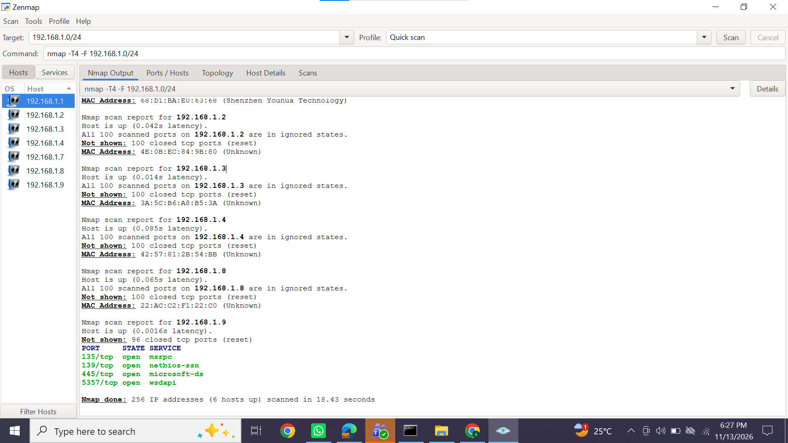

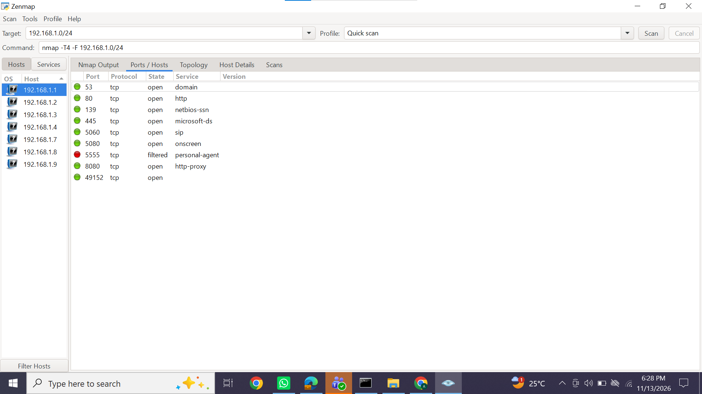

**Result:** The quick scan (`nmap -T4 -F 192.168.1.0/24`) scanned the 100 most common ports on each live device. For host 192.168.1.1, which appears to be the router, Nmap found 8 open ports: 53 (domain/DNS), 80 (http), 139 (netbios-ssn), 445 (microsoft-ds), 5060 (sip), 5080 (onscreen), 8080 (http-proxy) and 49152 (unknown). Port 5555 (personal-agent) was filtered, which means a firewall is blocking it. Open ports show which services a device offers, so each one is a possible entry point. Services such as SMB (445) and NetBIOS (139) should be closed if they are not needed.

### C5. Scan 3: Intense scan (my own PC)

- **Target:** 192.168.1.9
- **Profile:** Intense scan (`nmap -T4 -A -v`)
- **Purpose:** Get detailed information about my own machine: open ports, services, versions, and OS guess.

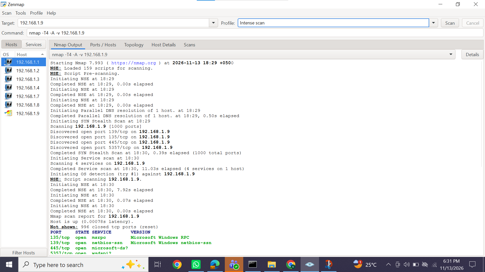
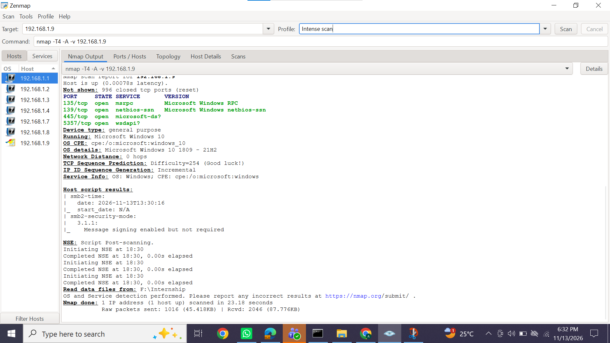

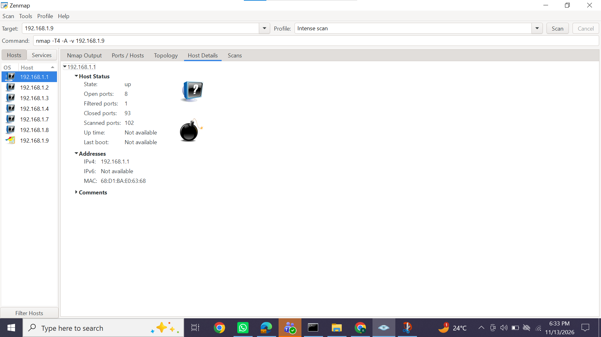

**Result:** The intense scan (`nmap -T4 -A -v 192.168.1.9`) was run on my own PC and finished in 23.18 seconds. Of the 1000 scanned ports, 4 were open and 996 were closed. The open ports were 135 (msrpc, Microsoft Windows RPC), 139 (netbios-ssn), 445 (microsoft-ds / SMB) and 5357 (wsdapi). Nmap identified the device as a general-purpose computer running Microsoft Windows 10 (versions 1809 to 21H2). The SMB script showed that message signing is enabled but not required, which means SMB traffic is not forced to be signed. These open ports are normal Windows services, but they should be blocked by the firewall on untrusted networks to reduce the attack surface.

---

## 7. Summary of Findings

| Area | Key finding |
|---|---|
| Domain | Registered with GoDaddy; DNS hosted on HostGator name servers |
| Web server | Apache on WordPress, with ModSecurity WAF in front |
| Missing headers | HSTS, X-Frame-Options, X-Content-Type-Options and CSP were not seen in the curl output |
| DNS | DNSSEC does not appear to be enabled |
| Local network | 7 live hosts; router has 8 open ports including SMB (445) and NetBIOS (139) |
| My PC | 4 open Windows ports (135, 139, 445, 5357); SMB signing enabled but not required |

## 8. Conclusion

This week I learned how to collect information about a domain using WHOIS, DNS lookups, and web fingerprinting tools, and how to map a network and its open ports with Nmap/Zenmap. I also learned why permission and scope matter: scans were run only on my own network, as required by my instructor's letter. Even without attacking anything, public information and open ports reveal a lot about a target, which is why reconnaissance is the foundation of every penetration test.